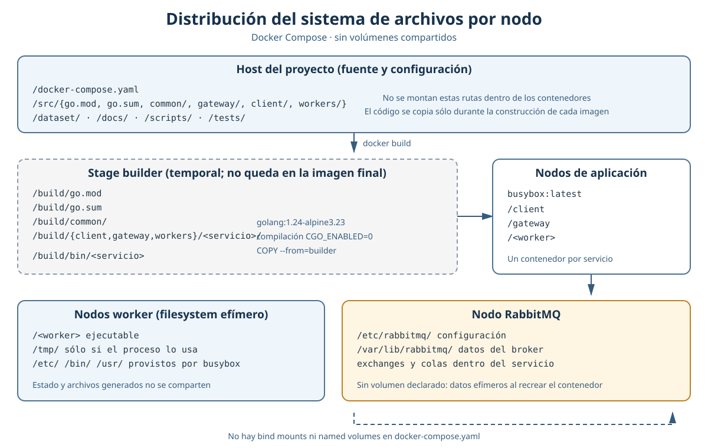

## Vista previa temporal
La figura resume qué archivos existen en el host
del proyecto, cuáles se usan sólo durante la construcción de las imágenes y
qué queda en cada contenedor en ejecución. El archivo
`docker-compose.yaml` no declara `bind mounts` ni `named
volumes` el código fuente no se monta en los servicios y el filesystem de
cada contenedor es independiente y efímero. Los stages `builder` de
las imágenes Go se descartan luego de copiar el ejecutable a la imagen final.

En el despliegue base de `docker-compose.yaml`, los contenedores no
declaran montajes locales: cualquier archivo temporal que cree un worker queda
en la capa efímera de su contenedor y no se comparte entre hosts. Una
instalación que requiera conservar los archivos temporales de Q2--Q5 debe
agregar explícitamente un volumen local al worker propietario; aun así, no se
introduce una base de datos ni almacenamiento compartido entre hosts. El
despliegue debe proveer memoria y disco acordes con las cuotas de las
instancias alojadas.
