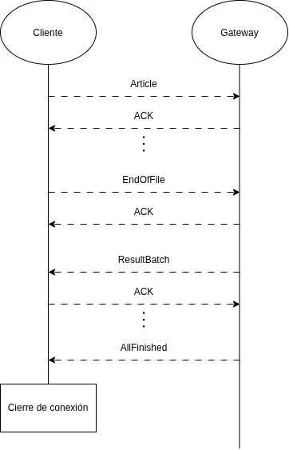

# Protocolo de comunicación

El protocolo de comunicación para el sistema debe estar dividido en dos partes:
* Una parte para la comunicación entre **CLiente y Gateway**, que se comunican mediante conexión TCP.
* Otra parte para la comunicación entre el resto de **nodos**, que intercambian mensajes mediantes colas/exchanges de RabbitMQ.

Para ambas partes del protocolo, la idea principal es utilizar `Protobuf` para el marshalling/unmarshalling de mensajes.

## Protocolo entre Cliente y Gateway

La comunicación entre cliente y gateway se lleva a cabo directamente mediante TCP. El cliente es responsable de enviar los artículos de Wikipedia que deben procesarse. El gateway recibe los artículos, coordina su procesamiento mediante los nodos internos del sistema distribuido y devuelve al cliente los resultados de las cinco consultas requeridas.

### Formato de mensajes

El formato general de los mensajes intercambiados es el siguiente:

```text
+--------------------+---------------------------------+
|  Length (4 bytes)  |  Serialized Message (N bytes)   |
+-------------------------------+----------------------+
```

Donde:
* **Length**: entero sin signo de 32 bits que indica la cantidad de bytes del mensaje serializado. Este prefijo es necesario para delimitar los mensajes sobre TCP, que proporciona unicamente un flujo de bytes.

* **Serialized Message**: secuencia de bytes obtenida al serializar un mensaje mediante Protobuf. Esta secuencia debe corresponder a uno de los tipos de mensajes que se definirán más adelante.

* **N**: longitud del mensaje serializado. Puede variar según el tipo de mensaje y la cantidad de información que contenga. Se obtiene a partir de _Length_.

### Escritura y lectura de mensajes

Para escribir y enviar un mensaje, tanto cliente como gateway deben:

1. Serializar el mensaje utilizando Protobuf.

2. Obtener la cantidad de bytes del mensaje serializado.

3. Codificar esa longitud en cuatro bytes.

4. Escribir el prefijo de longitud seguido de los bytes serializados.

5. Comprobar que la operación de escritura haya finalizado correctamente.


Por otro lado, al recibir y leer un mensaje deben:

1. Leer exactamente cuatro bytes para obtener el prefijo de longitud.

2. Decodificar el prefijo como un entero sin signo de 32 bits.

3. Leer exactamente la cantidad de bytes indicada por el prefijo.

4. Deserializar esos bytes utilizando Protobuf.

5. Validar el tipo de mensaje recibido y procesarlo de acuerdo a este.

Todas las escrituras y lecturas realizadas en ambos lados del protocolo deben ser llevadas a cabo mediante las funciones del modulo `safe_socket`, de modo que no se produzcan short-reads ni short-writes que alteren el correcto procesamiento de la información.

### Tipos de mensajes

Como ya se mencionó en la sección de _Formato de mensajes_, en el campo de Serialized Message pueden ir distintos tipos de mensajes que intercambian cliente y gateway. Estos son: 


| Mensaje | Descripción |
|---|---|
| `Article` | Información de un artículo, eviado desde cliente hacia gateway.  |
| `EndOfFile` | Mensaje de finalización de cliente a servidor para indicar cuando todos las artículos a procesar ya fueron enviados. |
| `ACK` | Utilizado para la confirmación de recepción de mensajes |
| `ResultBatch` | Batch de resultados parciales para una query enviados por el gateway al cliente. |
| `AllFinished` |  Mensaje de aviso al cliente de que todas las queries ya fueron finalizadas. |

---

#### Mensaje de tipo 'Article'

Al representar un artículo de Wikipedia, este mensaje contiene todos los campos con los que cuenta un artículo de acuerdo al datasaet de entrada:

| Campo | Descripción |
|---|---|
| `name` | Título del artículo. |
| `identifier` | identififcador (id) del artículo |
| `url` | URL del artículo. |
| `date_created` | Fecha de creación. |
| `date_modified` | Fecha de última modificación.  |
| `is_part_of` | Proyecto de Wikimedia al que pertenece. |
| `in_language` | Idioma en el que está escrito. |
| `license` | Lista de licencias. |
| `description` | Descripción breve del contenido. |
| `abstract` | Resumen/introducción del artículo |
| `image` | Imagen principal y sus metadatos. |
| `main_entity` | Entidad principal de Wikidata. |
| `additional_entities` | Lista de entidades adicionales. |
| `version` | Datos de la versión del artículo. |
| `infoboxes` | Estructuras de infoboxes. |
| `sections` | Estructuras de secciones del contenido. |
| `tables` | Estructuras de tablas. |
| `references` | Lista de referencias bibliográficas. |

El gateway debe validar los campos necesarios antes de incorporar el artículo al procesamiento distribuido. Los campos opcionales pueden omitirse cuando no estén disponibles, siempre y cuando eso no impida satisfacer las consultas correspondientes. Idealmente, el cliente también debería hacer esta validación, para no enviar mensajes que no correspondan.

Cada Article representa un único artículo. Por lo tanto, un conjunto de entrada de N artículos se transmite mediante N mensajes Article, seguidos por un mensaje EndOfFile **(TODO: Revisar esto en caso de implementar batches)**. Ante cada mensaje de este tipo, el cliente espera una confirmación del gateway (ACK) para seguir mandando los siguientes.


#### Mensaje de tipo 'EndOfFile'

El mensaje de EndOfFile no contiene campos de ningún tipo. Se utiliza únicamente como señalización para el servidor de que el cliente ya envió todo loq ue tenía para enviar. 

Una vez recibido, el gateway marca como finalizada la entrada de articulos para el cliente correspondiente y no acepta más mensajes de tipo Article. En caso de recibirse más información luego del EndOfFile, esta será ignorada.

#### Mensaje de tipo 'ACK'

Al igual que el EndOfFile, el mensaje de ACK no tiene información agregada, y se utiliza únicamente como mensaje de control. Al recibir este mensaje, tanto cliente como servidor saben que el último mensaje que hayan enviado fue correctamente recibido y que pueden continuar mandando información en caso de ser necesario. En el prtocolo propuesto, se utilizará el ACK para confirmar:

* Los mensajes Article recibidos por el gateway.

* El mensaje EndOfFile recibido por el gateway.

* Los mensajes ResultBatch recibidos por el cliente.

#### Mensaje de tipo 'ResultBatch'

Al contener los resultados (parciales o finales) de una determinada query, este mensaje cuenta con los campos pertinentes:

 Campo | Descripción |
|---|---|
| `query_id` | Número de la query a la que corresponden los resultados. |
| `results` | Listado/batch de los resultados obtenidos desde el sistema |

No es necesario que el gateway haya recibido el EndOfFile ni que todas las consultas hayan sido resueltas para comenzar a enviar los resultados

Para aquellas querys que admiten resultados parciales (Q1, Q2 y Q3), el gateway puede comenzar a enviar ResultBatch antes de haber recibido el EndOfFile. En cambio, no deberían enviarse mensajes de ResultBatch antes de haber recibido el EndOfFile para aquellas queries que requieren procesar toda la entrada antes de producir sus primeros resultados (Q4 Y Q5).

#### Mensaje de tipo 'AllFinished'

Este mensaje, como el de EndOfFile y ACK, tampoco contiene campos ni información. Una vez finalizado el procesamiento de todas las consultas del sistema y enviados todos los resultados, el gateway envía este mensaje para indicar al cliente que debe esperar más resultados y que puede darse por concluida la sesión. El cliente puede cerrar la conexión una vez que haya recibido esta señal.




## Protocolo entre nodos internos

La comunicación entre los nodos internos del sistema distribuido se lleva a cabo mediante RabbitMQ, utilizando exchanges y colas para distribuir los mensajes entre los componentes responsables de procesar las consultas.

El gateway es responsable de coordinar el procesamiento de los artículos recibidos y publicar los mensajes necesarios para iniciar el procesamiento distribuido. Los nodos internos consumen estos mensajes, ejecutan las operaciones que les corresponden y publican los resultados parciales o finales para que sean procesados por otros nodos.

Al igual que en la comunicación entre cliente y gateway, se utilizará `Protobuf` para el marshalling y unmarshalling de los mensajes. 

### Formato de los mensajes

Los mensajes intercambiados a través de RabbitMQ se serializan utilizando Protobuf. A diferencia de la comunicación mediante TCP, RabbitMQ ya delimita los mensajes individuales, por lo que no es necesario incorporar un prefijo de longitud de cuatro bytes como el definido en el protocolo entre cliente y gateway.

Cada mensaje publicado debe incluir el contenido serializado correspondiente al tipo de mensaje que representa. Para distinguir los diferentes tipos de información intercambiada, definimos un mensaje general que contenga los siguientes campos:

| Campo | Descripción |
|---|---|
| `client_id` | Identificador del cleinte al que pertenece el mensaje, con el fin de separar mensajes entre distintos clientes. |
| `payload` | Contenido específico del mensaje. Corresponde a otro mensaje de Protbuf representado mediante un campo `oneof`|

El sobre `InternalMessage` se conserva también en el retorno
`ResultCollector → RabbitMQ → Gateway`. Sus payloads `result_batch` y
`all_finished` reutilizan las definiciones `ResultBatch` y `AllFinished` del
protocolo externo, sin duplicar los esquemas. Gateway selecciona la conexión
mediante `client_id` y coloca el mismo payload en `ExternalMessage` para TCP.
El wrapper `middleware.Message` contiene únicamente el cuerpo serializado;
la identidad del cliente permanece en Protobuf.

La implementación actual de ese retorno está limitada al modo de pruebas
`Q1_TEST_MODE=1`: el EOF de Q1 permite producir `AllFinished` sólo dentro de ese
alcance. El cierre de las cinco consultas continúa pendiente.


### Tipos de mensajes
Los tipos concretos de mensajes que se utilizan en el lugar del `payload` del mensaje base son los siguientes:

| Mensaje | Descripción |
|---|---|
| `Article` | Artículo original recibido desde el gateway. Es el mismo que se utiliza entre cliente y gateway. |
| `ProjectedArticle` | Artículo con los campos necesarios para las consultas, generado por `Project`. |
| `DateFiltered` | Artículo que cumple con los filtros de tiempo de los `DateFilter` y que solo contiene los campos necesarios para Q1 y Q2. |
| `TokenizedAbstract` | Palabras obtenidas de tokenizar el abstract de los artículos mediante los `WordTokenizer` y que solo contiene los campos necesarios para Q3, Q4 y Q5. |
| `ResultBatch` | Lote de resultados enviado por ResultCollector a Gateway, conservando `client_id` en el sobre interno. |
| `AllFinished` | Finalización enviada por ResultCollector a Gateway dentro del mismo sobre interno. |

### Mensajes comunes entre queries

#### Mensaje de tipo 'PojectedArticle'

Este tipo de mensaje es producido por los nodos de tipo _Project_ a aprtir de un mensaje de tipo Article. El resultado es un mensaje muy similar a Article, pero excluyendo los campos que no son utilizados por ninguna query:

| Campo | Descripción |
|---|---|
| `name` | Título del artículo. |
| `url` | URL del artículo. |
| `date_modified` | Fecha de última modificación.  |
| `in_language` | Idioma en el que está escrito. |
| `abstract` | Resumen/introducción del artículo |
| `image` | Imagen principal y sus metadatos. |
| `sections` | Estructuras de secciones del contenido. |

Este mensaje luego es recibido por los nodos de _WordTokenizer_ y _DateFilter_ para su posterior procesamiento.


#### Mensaje de tipo 'DateFiltered'

Los mensajes de tipo DateFilteredson producidos por los `DateFilter`. Excluyen el campo de abstract, que es el único que no es necesitado por los nodos de `EnglishFilter` o `BioFilter`, que continuan con el procesamiento de la información para las queries 1 y 2 respectivamente.

| Campo | Descripción |
|---|---|
| `name` | Título del artículo. |
| `url` | URL del artículo. |
| `date_modified` | Fecha de última modificación.  |
| `in_language` | Idioma en el que está escrito. |
| `image` | Imagen principal y sus metadatos. |
| `sections` | Estructuras de secciones del contenido. |

#### Mensaje de tipo 'TokenizedAbstract'

Similar a los mensajes de DateFiltered, los mensajes de TokenizedAbstract son producidos por los `WordTokenizer`. Dejan solo los campos que utilizan los nodos de `ShardRouter`, `WordCountReducer` y `WordCounter`, que cada uno respectivamente sigue trabajando para producir los resultados de las queries 3, 4 y 5.

| Campo | Descripción |
|---|---|
| `abstract_words` | Palabras del asbtract tokenizadas. |
| `url` | URL del artículo. |
| `date_modified` | Fecha de última modificación.  |
| `in_language` | Idioma en el que está escrito. |


##
### Mensajes utilizados en la query 1

#### Mensaje de tipo 'Q1Result'

| Campo | Descripción |
|---|---|
| `url` | URL del artículo. |
| `date_modified` | Fecha de última modificación.  |

##
### Mensajes utilizados en la query 2

#### Mensaje de tipo 'BioFiltered'

| Campo | Descripción |
|---|---|
| `name` | Título del artículo. |
| `url` | URL del artículo. |
| `image` | Imagen principal y sus metadatos. |

#### Mensaje de tipo 'Q2Result'

| Campo | Descripción |
|---|---|
| `name` | Título del artículo. |
| `url` | URL del artículo. |
| `image_bytes` | Bytes de la imagen del artículo. |

##
### Mensajes utilizados en la query 3

#### Mensaje de tipo 'ShardedWord'

| Campo | Descripción |
|---|---|
| `sharded_word` | Palabra shardeada a un `WordAppearanceDetector` específico. |
| `in_language` | Idioma en el que está escrito. |

#### Mensaje de tipo 'Q3Result'

| Campo | Descripción |
|---|---|
| `english_word` | Palabras del asbtract tokenizadas. |
| `french_word` | Idioma en el que está escrito. |

##
### Mensajes utilizados en la query 4

#### Mensaje de tipo 'Top/Q4Result'

| Campo | Descripción |
|---|---|
| `Top` | Listado de top 20 palabras más frecuentes y sus cantidades obtenido por un `WordCountReducer` o un `TopKReducer`|

##
### Mensajes utilizados en la query 5

#### Mensaje de tipo 'WordsCounted'

| Campo | Descripción |
|---|---|
| `word_count` | Cantidad de palabras en el abstract. |
| `url` | URL del artículo. |
| `date_modified` | Fecha de última modificación. |

#### Mensaje de tipo 'DateFilteredCount/Q5Result'

| Campo | Descripción |
|---|---|
| `word_count` | Cantidad de palabras en el abstract. |
| `url` | URL del artículo. |

#### Mensjae de tipo 'SummedLens'

| Campo | Descripción |
|---|---|
| `words_count` | Cantidad total de palabras en los abstract de todos los artículos contenidos. |
| `article_count` | Cantidad de artículos contenidos. |


#### Mensaje de tipo 'Average'

| Campo | Descripción |
|---|---|
| `average_len` | Promedio de palabras en los abstracts de los artículos. |

### TODO: Emprolijar y explicar mensajes de queries
